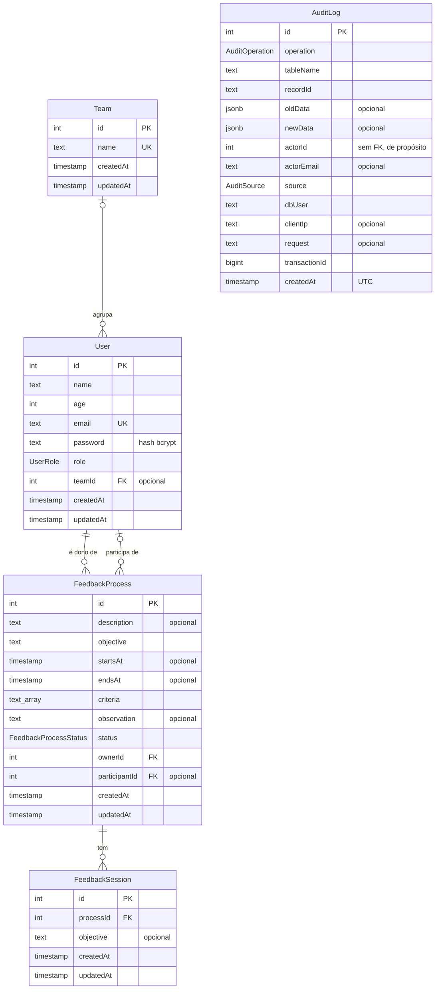

# Banco de dados (PostgreSQL no Neon)

Como o banco do sistema está organizado, como conseguir acesso e como trabalhar
com migrações. Responsável: camada de banco de dados (Fillipe).

> Auditoria das alterações: [`docs/auditoria.md`](auditoria.md).
> Análise de segurança: [`docs/analise-seguranca.md`](analise-seguranca.md).

---

## 1. Visão geral

O banco compartilhado da equipe fica no [Neon](https://neon.tech), um
PostgreSQL gerenciado:

- **Projeto:** `tcc20261`.
- **Versão:** PostgreSQL 17, a mesma do Compose local.
- **Região:** `aws-us-east-1`. O Neon não tem região no Brasil, e esta é a
  mais próxima entre as disponíveis.

```
API NestJS ── DATABASE_URL (usuário tcc_app, pelo pooler) ──┐
                                                             ├──► Neon (PostgreSQL 17)
Prisma Migrate ── DIRECT_URL (usuário tcc_owner, direto) ───┘
```

O projeto tem duas *branches*, cada uma um banco independente, com endereço e
senhas próprios:

| *Branch* | Uso | Quem acessa |
|---|---|---|
| `main` | Ambiente oficial: apresentações, defesa e futura implantação | Responsável pelo banco |
| `dev` | Desenvolvimento e testes da equipe | Equipe |

As senhas da `dev` **não** funcionam na `main`. Isso foi verificado.

---

## 2. Modelo de dados

### 2.1 Diagrama entidade-relacionamento



A `AuditLog` não se liga a nenhuma tabela por chave estrangeira. Isso é de
propósito: o histórico precisa sobreviver à exclusão do usuário que fez a
operação (ver [`docs/auditoria.md`](auditoria.md)).

### 2.2 Dicionário de dados

Os tipos são os do PostgreSQL. `TIMESTAMP(3)` guarda milissegundos e, nas
colunas gravadas pelo Prisma, fica em UTC.

**`Team`**: equipes da empresa.

| Coluna | Tipo | Nulo | Regras |
|---|---|---|---|
| `id` | `SERIAL` | não | Chave primária |
| `name` | `TEXT` | não | Único |
| `createdAt` / `updatedAt` | `TIMESTAMP(3)` | não | Criação / última alteração |

**`User`**: pessoas que acessam o sistema.

| Coluna | Tipo | Nulo | Regras |
|---|---|---|---|
| `id` | `SERIAL` | não | Chave primária |
| `name` | `TEXT` | não | |
| `age` | `INTEGER` | não | A API aceita de 1 a 120 |
| `email` | `TEXT` | não | Único; usado no login |
| `password` | `TEXT` | não | *Hash* bcrypt (custo 10). Nunca aparece na auditoria |
| `role` | `UserRole` | não | `ADMIN_RH`, `ADMIN_LEADER` ou `TEAM_MEMBER` (padrão) |
| `teamId` | `INTEGER` | sim | FK → `Team.id`, `ON DELETE RESTRICT` (não se apaga equipe com usuários). Indexada |
| `createdAt` / `updatedAt` | `TIMESTAMP(3)` | não | |

**`FeedbackProcess`**: processos de *feedback* planejados por um líder para um membro.

| Coluna | Tipo | Nulo | Regras |
|---|---|---|---|
| `id` | `SERIAL` | não | Chave primária |
| `description` | `TEXT` | sim | A API limita a 1000 caracteres |
| `objective` | `TEXT` | não | Padrão `''`; a API exige e limita a 500 caracteres |
| `startsAt` / `endsAt` | `TIMESTAMP(3)` | sim | Obrigatórios fora do rascunho, com início antes do término |
| `criteria` | `TEXT[]` | não | Lista de critérios; padrão vazia. Fora do rascunho, exige ao menos um |
| `observation` | `TEXT` | sim | Observação do RH. A API limita a 2000 caracteres |
| `status` | `FeedbackProcessStatus` | não | `DRAFT` (padrão) → `SENT_FOR_VALIDATION` → `PLANNED` |
| `ownerId` | `INTEGER` | não | FK → `User.id` (líder dono), `ON DELETE CASCADE`. Indexada |
| `participantId` | `INTEGER` | sim | FK → `User.id` (membro avaliado), `ON DELETE SET NULL`. Indexada |
| `createdAt` / `updatedAt` | `TIMESTAMP(3)` | não | |

**`FeedbackSession`**: sessões de *feedback* criadas dentro de um processo planejado.

| Coluna | Tipo | Nulo | Regras |
|---|---|---|---|
| `id` | `SERIAL` | não | Chave primária |
| `processId` | `INTEGER` | não | FK → `FeedbackProcess.id`, `ON DELETE CASCADE`. Indexada. A API só cria sessão em processo `PLANNED` do próprio líder |
| `objective` | `TEXT` | sim | Objetivo da sessão, definido depois da criação. A API exige de 1 a 500 caracteres e só o líder dono do processo define |
| `createdAt` / `updatedAt` | `TIMESTAMP(3)` | não | |

**`AuditLog`**: registro imutável das alterações, gravado só por *trigger*.

| Coluna | Tipo | Nulo | Regras |
|---|---|---|---|
| `id` | `SERIAL` | não | Chave primária |
| `operation` | `AuditOperation` | não | `INSERT`, `UPDATE` ou `DELETE` |
| `tableName` / `recordId` | `TEXT` | não | Tabela e id do registro alterado. Índice conjunto |
| `oldData` / `newData` | `JSONB` | sim | Linha antes e depois; a senha aparece como `[PROTEGIDO]` ou `[ALTERADO]` |
| `actorId` / `actorEmail` | `INTEGER` / `TEXT` | sim | Usuário da API que fez a operação. Sem FK. `actorId` indexado |
| `source` | `AuditSource` | não | `APPLICATION` (pela API) ou `DATABASE` (direto no banco) |
| `dbUser` | `TEXT` | não | Usuário do PostgreSQL da conexão |
| `clientIp` / `request` | `TEXT` | sim | IP e rota HTTP (sem a *query string*) |
| `transactionId` | `BIGINT` | não | Id da transação; agrupa operações feitas juntas |
| `createdAt` | `TIMESTAMP(3)` | não | Gravado em UTC pelo *trigger*. Indexada |

### 2.3 Objetos do banco fora do Prisma

Criados pelas migrações em SQL. O Prisma não os gerencia, mas eles fazem parte
do banco:

| Objeto | Tipo | Função |
|---|---|---|
| `audit_record_change()` | Função de *trigger* (`SECURITY DEFINER`) | Grava cada alteração na `AuditLog` |
| `audit_trigger` em `User`, `Team`, `FeedbackProcess` e `FeedbackSession` | *Trigger* `AFTER ... FOR EACH ROW` | Chama a função acima |
| `audit_log_block_changes()` e os *triggers* `AuditLog_block_*` | Função e *triggers* `BEFORE` | Impedem UPDATE, DELETE e TRUNCATE na `AuditLog` |
| `audit_enable(tabela)` | Função | Ativa a auditoria numa tabela nova |
| `audit_trusted_role()` | Função | Diz qual usuário de banco é a API (ver [`docs/auditoria.md`](auditoria.md), seção 5) |

### 2.4 Observações de modelagem

Decisões que vale conhecer:

- **`criteria`** é uma coluna do tipo *array*. Isso fere a 1ª forma normal (atributo multivalorado). Uma tabela própria seria o modelo normalizado; o *array* simplifica e atende ao uso atual.
- **`age`** guarda a idade, que muda com o tempo. Guardar a data de nascimento evitaria dados desatualizados (ver a análise de segurança).
- **Exclusão de usuário em cascata:** apagar o dono apaga os processos dele (#108). A auditoria preserva uma cópia do que foi apagado.
- **Exclusão de processo em cascata:** apagar o processo apaga as sessões dele.

---

## 3. Usuários do banco

| Usuário | Para que serve | Onde é usado |
|---|---|---|
| `tcc_owner` | Dono das tabelas. Aplica migrações e roda os scripts de administração | `DIRECT_URL` |
| `tcc_app` | Usuário da API, com **privilégios mínimos** (issue #106) | `DATABASE_URL` |

O que o `tcc_app` pode e não pode fazer (verificado em 12/10/2026):

| Pode | Não pode |
|---|---|
| Ler e gravar nas tabelas do sistema (`User`, `Team`, `FeedbackProcess`...) | Alterar, apagar ou truncar a `AuditLog` (só lê) |
| Usar as sequências dos ids | Ler a tabela `_prisma_migrations` |
| | Criar, alterar ou apagar tabelas |
| | Desativar *triggers* ou redefinir funções |
| | Criar usuários ou bancos |

As tabelas criadas por migrações futuras já nascem com leitura e escrita para o
`tcc_app` (*default privileges*).

---

## 4. Variáveis de ambiente

| Variável | Conteúdo | Usada por |
|---|---|---|
| `DATABASE_URL` | Conexão do `tcc_app`, pelo endereço com `-pooler` | API (Prisma Client) |
| `DIRECT_URL` | Conexão do `tcc_owner`, pelo endereço direto (sem `-pooler`) | Prisma Migrate e `npm run db:app-role` |

As URLs do Neon terminam com `?sslmode=require&channel_binding=require`.
Mantenha esses parâmetros.

Ao iniciar, o driver `pg` mostra um aviso de segurança sobre `sslmode`. Ele
avisa que, hoje, `require` já é tratado de forma mais rígida (verificação
completa do certificado). Pode ser ignorado.

Em um PostgreSQL local com um único usuário, as duas variáveis podem ser
iguais. O Compose já gera assim.

O `.env` é carregado na primeira linha do `main.ts`, antes de qualquer módulo.
Não mude essa ordem: alguns módulos leem variáveis no momento em que são
importados.

---

## 5. Como conseguir acesso e rodar a API

1. Peça ao responsável pelo banco as URLs da *branch* `dev`. Elas são passadas
   **por canal privado**, nunca em *issue*, PR, *commit* ou arquivo do
   repositório.
2. Copie `backend/.env.example` para `backend/.env` e preencha `DATABASE_URL`,
   `DIRECT_URL`, `JWT_SECRET` e o administrador inicial.
3. Rode a API normalmente:

```bash
cd backend
npm ci
npx prisma generate
npm run start:dev
```

---

## 6. Migrações

**Criar** uma migração depois de alterar o `schema.prisma` (testado no Neon):

```bash
npx prisma migrate dev --name descricao-curta
```

**Aplicar** as migrações existentes em um ambiente, usando a `DIRECT_URL`
desse ambiente:

```bash
npx prisma migrate deploy
```

Cuidados:

- **Tabela nova que deve ser auditada:** inclua na migração
  `SELECT audit_enable('"NomeDaTabela"');`.
- **Tabela nova que a API não pode alterar** (como a `AuditLog`): acrescente a
  exceção em `prisma/configure-app-role.mjs` e rode `npm run db:app-role` de
  novo.
- **Nunca redefina** `audit_trusted_role()` em migrações (ver
  [`docs/auditoria.md`](auditoria.md), seção 5).

---

## 7. Configurar o usuário da API em um ambiente novo

Rode uma vez por ambiente, depois das migrações, com a `DIRECT_URL` do dono:

```bash
APP_DB_PASSWORD="<senha forte, 16+ caracteres>" npm run db:app-role
```

O script `prisma/configure-app-role.mjs`:

- cria o `tcc_app` (ou atualiza a senha, se já existir);
- aplica as permissões da seção 3;
- define o `tcc_app` como papel confiável da auditoria;
- remove qualquer associação do `tcc_app` a outros papéis. Como membro do dono,
  ele poderia usar `SET ROLE` e desligar a auditoria;
- confirma no final que o usuário não tem nenhum poder administrativo nem pode
  assumir outro papel. Se algo sobrar, falha e desfaz tudo.

Ele pode ser executado de novo sem efeito colateral, por exemplo para trocar a
senha.

---

## 8. Conectar pelo pgAdmin

Em *Register → Server*, aba *Connection*:

- **Host:** o endereço **direto** da *branch*, sem `-pooler`, copiado do painel
  do Neon.
- **Port:** `5432` · **Database:** `tcc`
- **Username:** `tcc_app` para consultar, ou `tcc_owner` só para
  administração.

Na aba *Parameters*, defina **SSL mode** como `require`.

Alterações feitas pelo pgAdmin ficam registradas na auditoria com origem
`DATABASE`.

---

## 9. Containers (Compose)

O Compose continua com o PostgreSQL local, sem depender do Neon. O script
`scripts/create-container-env.mjs` agora também gera a `DIRECT_URL`, igual à
`DATABASE_URL`, porque o container de migração passou a precisar dela.

Rodar os containers apontando para o Neon ainda **não foi definido nem
testado**. A combinação fica para quando a hospedagem for escolhida, junto com
a frente de infraestrutura.

---

## 10. Cuidados com o plano gratuito

- **Pausa por inatividade:** o Neon desliga o servidor do banco depois de um
  tempo sem uso. A primeira consulta seguinte demora um pouco mais.
- **Restauração:** uma *branch* pode voltar a um momento anterior com
  `neonctl branches restore`, dentro da janela que o plano gratuito permite.
- **Testes de integração:** não rode contra a `dev` nem contra a `main`. Eles
  criam usuários de teste, inclusive um `ADMIN_RH`, o que impede a criação do
  administrador inicial. Use o PostgreSQL local ou uma *branch* temporária:

```bash
neonctl branches create --name teste-seu-nome --parent dev
# ... rodar os testes ...
neonctl branches delete teste-seu-nome
```

---

## 11. Verificações feitas na integração (12/10/2026)

- **Migrações:** as 13 aplicadas no Neon, incluindo os *triggers* e as funções
  da auditoria.
- **API:** completa rodando contra o Neon como `tcc_app`. Login, equipes,
  usuários, processos de *feedback*, aprovação e exclusão em cascata foram
  auditados corretamente.
- **Testes de integração da auditoria:** os 8 passaram contra o Neon.
- **Privilégios mínimos:** as tentativas de alterar a auditoria, ler as
  migrações, criar tabela, desativar *triggers* e redefinir o papel confiável
  foram todas negadas ao `tcc_app`.
- **Falsificação:** uma sessão do dono que se passou pela aplicação foi
  registrada como `DATABASE`, sem autor.
- **Isolamento das *branches*:** a senha da `main` não funciona na `dev`.
