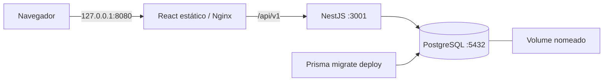

# Containers portáveis

Configuração de containers para [PedroLLou/tcc20261](https://github.com/PedroLLou/tcc20261).

As imagens usam Containerfiles padrão e Compose. Podman é o runtime local; Docker também pode executar a mesma configuração. Não há dependência de provedor de nuvem, diretórios do host, socket do runtime dentro dos containers ou arquitetura de CPU fixada. As imagens são Linux; máquinas Windows/macOS precisam de um runtime com VM Linux. ARM64 e builds com emulação ainda precisam de teste.

## Serviços e eficiência



| Imagem | Construção e execução |
| --- | --- |
| Frontend | Node 24 compila React; a imagem final contém Nginx sem root e `build/`, sem Node, npm ou dependências do frontend |
| API | Node 24 em Distroless Debian 13, usuário `65532:65532`, dependências de produção e cliente Prisma com engine JavaScript; não contém shell, npm, TypeScript ou CLI Prisma |
| Migração | Node 24 em Debian trixie slim, CLI Prisma e dotenv nas versões do lockfile; aplica as migrações existentes e encerra |
| Banco | `docker.io/library/postgres:17-alpine`, dados em `/var/lib/postgresql/data`; o projeto não requer extensões externas |

Instalações usam `npm ci` e os lockfiles existentes. Os estágios de dependências permitem reutilizar o cache ao alterar os fontes. Builds e dependências locais ficam fora dos contextos. O runtime da API remove dependências de desenvolvimento e opcionais, incluindo o CLI Prisma que `@prisma/client` referencia como peer opcional. O build também remove sourcemaps e declarações de tipos das dependências de produção. O build verifica a ausência de Prisma CLI e TypeScript e o carregamento de Prisma Client, bcrypt e dotenv.

O backend compila em `node:24-trixie-slim` e executa em `gcr.io/distroless/nodejs24-debian13:nonroot`. Prisma usa `engineType = "client"` e `PrismaPg`, sem engine Rust no runtime. A extensão de auditoria permanece ativa. O pool de negócio aceita até quatro conexões, com aquisição e consultas limitadas a dez segundos. A imagem de migração mantém o CLI separado da API. O estágio `runtime-slim` permite comparar o runtime Debian slim com o Distroless.

O frontend usa `/api/v1` no navegador. A autenticação reutiliza o cliente HTTP de `api.ts` e rotas `/auth/*`, corrigindo o prefixo duplicado `/api/v1/api/v1` na configuração relativa ou de API externa. Nginx resolve `api` pelo DNS de `/etc/resolv.conf` da rede do runtime, sem endereço de DNS específico do Docker, e atualiza a resolução se a API for recriada. A configuração gerada e os arquivos temporários ficam em `/tmp`, permitindo filesystem somente leitura. O frontend comprime respostas, armazena assets com hash em cache e não publica sourcemaps. HTML não recebe cache longo; um asset ausente retorna 404; outros caminhos recebem o fallback da SPA.

As bases possuem registro e versão explícitos. Os argumentos `NODE_IMAGE`, `RUNTIME_IMAGE` e `WEB_IMAGE` permitem espelhos ou digests. Tags podem receber atualizações de segurança e não garantem bytes idênticos. Registre os digests da release escolhida. A compatibilidade com Prisma e bcrypt foi verificada no runtime Distroless em amd64. RAM, latência da aplicação e comparação entre arquiteturas continuam sem benchmark.

Este guia inclui [observabilidade e OTLP](#observabilidade), [deploy no Render com Neon](#render-e-neon) e [resultados verificados](#validação-local).

## Preparação com Podman 5.8.2

A partir da pasta que contém os dois repositórios:

```sh
cd tcc20261
podman -v
podman info
podman compose --help
podman compose version
```

`podman -v` confirma a versão. `podman info` confirma acesso ao runtime. `podman compose` é um wrapper que delega a `podman-compose` ou `docker-compose`; ele não inclui um provedor. `--help` e `version` conferem o provedor realmente instalado. A sintaxe do wrapper e os comandos de build foram consultados na [documentação do Podman 5.8.2](https://docs.podman.io/en/v5.8.2/markdown/podman-compose.1.html).

Se aparecer `looking up compose provider failed`, o provedor não foi encontrado. Em Arch Linux, instalar o pacote oficial no terminal normal:

```sh
sudo pacman -S podman-compose
export PODMAN_COMPOSE_PROVIDER=/usr/bin/podman-compose
podman compose version
```

O [pacote do Arch](https://archlinux.org/packages/extra/any/podman-compose/) inclui as dependências Python. Esse preparo é do host; não altera imagens, Compose ou dependências da aplicação. Outros sistemas devem seguir os [métodos oficiais de instalação](https://github.com/containers/podman-compose#installation). O provedor Python executa Podman diretamente, sem exigir um serviço Docker.

Se houver mais de um provedor, selecionar explicitamente o desejado:

```sh
export PODMAN_COMPOSE_PROVIDER=podman-compose
podman compose --help
```

O provedor precisa implementar `service_healthy` e `service_completed_successfully` do padrão Compose. Não substituir essas condições por atrasos fixos: a API faz consultas e cria o administrador ao inicializar, portanto precisa encontrar o schema já migrado.

Limite observado por inspeção do [código de `podman-compose` 1.6.0](https://github.com/containers/podman-compose/blob/v1.6.0/podman_compose.py): `service_completed_successfully` aguarda a parada da migração sem conferir o código de saída impresso por `podman wait`. A condição declarada sozinha não comprova sucesso nesse provedor. Antes de usar os dados ou declarar a implantação validada, conferir o resultado da migração e executar o verificador completo, que também exige sucesso de `prisma migrate status`. Esse comportamento em caso de falha da migração ainda precisa de teste.

Para o helper de configuração e os testes, usar Node 24 ou superior. Para a verificação completa, usar também Bash e curl. A execução das imagens não exige Node ou npm no host.

## Configuração e inicialização

```sh
node scripts/create-container-env.mjs
podman compose config >/dev/null
podman compose build
podman compose up -d
podman compose ps
```

O helper cria `.env` com permissão `0600`, três segredos aleatórios independentes e URL de banco consistente. Ele recusa sobrescrever um arquivo existente. `.env.example` documenta as variáveis sem incluir senhas funcionais. Compose recusa segredos vazios. Consulte as credenciais localmente para fazer login. Não publique o arquivo nem a saída completa de `compose config`, que contém os segredos interpolados.

Abra `http://127.0.0.1:8080`. O administrador sintético inicial usa `DEFAULT_ADMIN_RH_EMAIL` e `DEFAULT_ADMIN_RH_PASSWORD` de `.env`. O projeto cria esse administrador apenas se ainda não houver um usuário `ADMIN_RH`; mudar a senha no arquivo após o primeiro início não redefine a senha armazenada.

Para outra porta, altere `WEB_PORT` em `.env`. A API e o banco ficam na rede interna. O arquivo básico publica apenas o frontend em loopback. Hospedagem remota deve definir publicação, domínio, HTTPS, gestão de segredos e backup conforme o ambiente escolhido.

A ordem é banco saudável, migração concluída, API saudável, frontend. O health check da API consulta `GET /api/v1/health/ready`, que exige uma consulta ao banco. `GET /api/v1/health/live` verifica somente a resposta do processo. O histórico ativo tem 12 migrações em `backend/prisma/migrations/`; não se usa `db push` nem o schema histórico do repositório `TCC`.

Para conferir as três respostas pelo frontend:

```sh
curl --fail http://127.0.0.1:8080/healthz
curl --fail http://127.0.0.1:8080/api/v1/health/live
curl --fail http://127.0.0.1:8080/api/v1/health/ready
```

O readiness usa um pool separado de uma conexão, com prazo de um segundo para conexão e 1,5 segundo para consulta. Banco indisponível produz HTTP `503`, com código `DATABASE_UNAVAILABLE`.

Para construir diretamente com Podman, sem Compose:

```sh
podman build --target runtime -f backend/Containerfile -t localhost/tcc20261-api:local backend
podman build --target migration -f backend/Containerfile -t localhost/tcc20261-migrate:local backend
podman build -f frontend/Containerfile -t localhost/tcc20261-frontend:local frontend
```

Esses comandos só constroem as imagens. Rede, volume, variáveis, execução da migração e inicialização ainda precisam ser coordenados pelo ambiente de execução. Em Docker, os mesmos Containerfiles podem ser construídos com `docker build`.

## Parada, atualização e dados

```sh
podman compose logs --tail=80
podman compose down
podman compose build
podman compose up -d
```

`down` remove containers e rede, preservando `postgres_data`. Ao subir novamente, a migração é repetida de forma idempotente e a API usa o volume preservado. Use o mesmo nome de projeto e arquivo `.env` para reencontrar o volume. Trocar `POSTGRES_PASSWORD` em `.env` não altera a senha de um banco já inicializado.

SIGTERM interrompe novas conexões HTTP e aguarda as requisições em andamento antes de fechar os providers do Nest e o Prisma. A exportação final de telemetria usa o prazo total de cinco segundos. Um destino OTLP indisponível não transforma o fechamento bem-sucedido da aplicação em erro.

Somente para apagar deliberadamente os dados desse projeto:

```sh
podman compose down --volumes
```

## Validação reproduzível

A partir da raiz deste repositório:

```sh
bash scripts/verify-containers.sh
```

Ou executar o mesmo teste com Docker:

```sh
CONTAINER_ENGINE=docker bash scripts/verify-containers.sh
```

O script usa um nome de projeto exclusivo, credenciais temporárias e a porta 18080. `TEST_WEB_PORT=18081` permite mudar a porta. Ele:

1. Confere runtime e provedor Compose e executa os testes do gerador de `.env`.
2. Constrói estágios de teste, executa a regressão das URLs com as dependências travadas, os testes atuais de backend/frontend e constrói as imagens finais.
3. Inicia os serviços, aguarda HTTP e consulta `prisma migrate status`.
4. Confere HTML React, JavaScript, fallback SPA, resposta 404 para asset ausente e chamadas pelo proxy.
5. Testa login, rejeição de credenciais inválidas e permissões; cria equipe, líder e membro sintéticos.
6. Cria rascunho de feedback, envia para validação e aprova como RH. Confere os registros reais de auditoria e os atores da criação e da atualização.
7. Recria os containers mantendo o volume e confere equipe, usuários e feedback.
8. Remove os containers, rede, volume e arquivos temporários exclusivos desse teste, inclusive em caso de falha. As imagens e o cache de build permanecem reutilizáveis.

O teste HTTP exerce a API através do frontend, mas não clica na interface. O ensaio de navegador e o benchmark de desempenho são verificações separadas. Para os sinais da API, execute também [o verificador de observabilidade](#verificar-sinais).

Para inspecionar as imagens construídas:

```sh
node scripts/inspect-container-images.mjs localhost/tcc20261-api:local localhost/tcc20261-migrate:local localhost/tcc20261-frontend:local
```

O helper informa tamanho descompactado, ID local, arquitetura, usuário e comando. Na API, confirma Node, bcrypt e a ausência de shell, npm, CLI Prisma e TypeScript. Use `CONTAINER_ENGINE=docker` para inspecionar imagens no Docker.

## Observabilidade

A API usa Pino JSON no stdout e OpenTelemetry para traces e métricas, com preload antes de Nest, Express, Prisma e Pino. Sem endpoint OTLP, mantém a operação e os logs locais. A auditoria permanece no PostgreSQL. O navegador não tem instrumentação OpenTelemetry, e os logs não são exportados por OTLP.

Cada requisição recebe um UUID do servidor em `X-Request-Id`. O evento `http.request.completed` registra uma vez método, rota normalizada, status, duração e IDs de request, trace e span quando disponíveis. Abort usa status `0` e código `REQUEST_ABORTED`. O servidor inicia seu próprio trace público e ignora `traceparent`, `tracestate`, baggage e flags de amostragem do cliente. A amostragem operacional é de 10%; spans internos preservam a relação pai-filho. Há spans manuais para `auth.verify_password`, `feedback.create` e `feedback.submit_for_validation`.

Logger e exporters filtram campos antes da serialização. Excluem headers, cookies, tokens, senhas, hashes, dados de usuário, texto de feedback, SQL, parâmetros, URLs brutas, query strings e mensagens ou stacks de erro. Eventos, links de span e atributos arbitrários ficam fora da exportação. Os recursos contêm apenas `service.name=tcc20261-api`, ambiente permitido e revisão hexadecimal válida. NGINX usa JSON com método permitido, categoria fixa de rota, status, duração e ID próprio; o log bruto de erros fica desativado porque pode expor dados da requisição.

As métricas HTTP usam somente método, rota e status como dimensões. Rotas desconhecidas usam `/unknown`, sem IDs concretos ou query strings.

| Métrica | Tipo e unidade |
| --- | --- |
| `tcc.http.request.count` | Contador, `{request}` |
| `tcc.http.request.duration` | Histograma, `s` |
| `tcc.process.memory.rss` | Gauge, `By` |
| `tcc.process.memory.heap` | Gauge, `By` |
| `tcc.process.cpu.time` | Contador, `s` |
| `tcc.process.event_loop.delay` | Gauge do p95 entre coletas, `s` |

Contador e histograma são cumulativos e contam toda requisição concluída ou abortada, independentemente da amostragem de traces. Isso inclui guards, validação e erros. O histograma usa limites `0`, `0.01`, `0.05`, `0.1`, `0.25`, `0.5`, `1`, `2`, `5` e `10` segundos; o limite zero separa o bucket inferior vazio dos tempos positivos curtos. Percentis remotos estimam valores dos buckets, e janelas interpoladas podem produzir contagens fracionárias. O verificador local confere a contagem exata.

### Configurar a API

No Compose, `.env` fornece as opções encaminhadas por `compose.yaml`:

| Variável | Padrão e contrato |
| --- | --- |
| `OTEL_SDK_DISABLED` | `false`; `true` desliga o SDK e preserva Pino |
| `OTEL_TRACES_SAMPLER_ARG` | `0.1`, limitado de `0` a `1` |
| `OTEL_EXPORTER_OTLP_ENDPOINT` | Vazio; URL-base, acrescida de `/v1/traces` e `/v1/metrics` |
| `OTEL_EXPORTER_OTLP_HEADERS` | Vazio; credenciais no formato `chave=valor`, separadas por vírgulas |
| `OTEL_EXPORTER_OTLP_PROTOCOL` | `http/protobuf`; `http/json` serve ao receptor de teste |
| `APP_RELEASE` | Revisão hexadecimal de 7 a 40 caracteres; `RENDER_GIT_COMMIT` é alternativa |
| `OTEL_RESOURCE_ATTRIBUTES` | Somente ambiente permitido e versão válida passam pelo filtro |
| `PORT` | `3001`; inteiro entre `1` e `65535`, bind em `0.0.0.0` |
| `CORS_ORIGINS` | Origens HTTP ou HTTPS exatas, separadas por vírgulas; vazio desativa CORS |

A porta interna da API no Compose é `3001`; execução direta e Render podem definir `PORT`. Ambientes permitidos são `local`, `development`, `test`, `prototype`, `staging` e `production`. O nome exportado do serviço é fixo em `tcc20261-api`.

Endpoints rejeitam credenciais, query e fragmento. Os headers de autenticação ficam separados e fora dos logs. URLs completas específicas podem usar `OTEL_EXPORTER_OTLP_TRACES_ENDPOINT` e `OTEL_EXPORTER_OTLP_METRICS_ENDPOINT`. A fila padrão comporta 512 spans, com lotes de até 128, exportação de traces a cada cinco segundos e métricas a cada 60 segundos. Cada exporter admite uma requisição simultânea e timeout de até três segundos. Erros usam apenas `EXPORT_FAILED`, com frequência limitada.

A configuração e os limites dos overrides estão em [config.ts](../backend/src/observability/config.ts), os filtros em [privacy.ts](../backend/src/observability/privacy.ts) e o preload em [instrumentation.ts](../backend/src/observability/instrumentation.ts). O desligamento total tem prazo de cinco segundos e preserva código zero quando Nest e Prisma fecham corretamente, mesmo com exporter indisponível.

### Exportar para Honeycomb

A aplicação precisa de uma Ingest Key do ambiente; o OAuth do plugin permite consultar os dados e é separado dessa credencial. No arquivo privado `.env`, configure:

```dotenv
OTEL_EXPORTER_OTLP_ENDPOINT=https://api.honeycomb.io
OTEL_EXPORTER_OTLP_HEADERS=x-honeycomb-team=<Ingest Key privada>
OTEL_EXPORTER_OTLP_PROTOCOL=http/protobuf
```

Na região europeia, use `https://api.eu1.honeycomb.io`. Não acrescente `/v1/traces` à URL-base. Crie a chave em **Environment Settings > API Keys**, com permissão para criar datasets no primeiro envio, ou crie antes `tcc20261-api`. Os traces usam esse dataset e as métricas nativas usam o dataset gerenciado `Metrics`, slug `metrics`, sem header `x-honeycomb-dataset`. Recrie a API após alterar o ambiente. Configure os mesmos valores privados no Render ao implantar.

### Verificar sinais

Execute na raiz do repositório, com Node 24 ou superior e Compose disponível:

```sh
node scripts/verify-observability.mjs
node --test tests/observability-verifier.test.mjs
```

O verificador cria projeto, credenciais e portas exclusivos, inicia API, PostgreSQL, frontend e receptor OTLP `http/json` local. Confere payloads completos e stdout com canários, correlação e hierarquia de spans, guards, validação, `400`, `401`, `403`, `404`, `500`, abort e contagem exata nas amostragens `1`, `0.1` e `0`. Também desliga o receptor e exige operações de negócio e SIGTERM com código zero. Nenhum destino remoto é usado.

`--skip-build` reutiliza `localhost/tcc20261-*:local` somente quando as imagens são desta mesma revisão. `CONTAINER_ENGINE=docker` seleciona Docker. O teste remove seu projeto, volume e temporários; `KEEP_TELEMETRY_ARTIFACTS=1` preserva arquivos brutos em diretório privado, que não deve ser publicado. `TEST_TELEMETRY_API_PORT` e `TEST_TELEMETRY_WEB_PORT` permitem fixar as portas. Os [resultados locais e remotos](#telemetria-local-e-honeycomb) registram o que foi comprovado.

## Render e Neon

O [render.yaml](../render.yaml) prepara dois web services Docker Free em Virginia: API com `backend/Containerfile` e readiness `/api/v1/health/ready`, frontend com `frontend/Containerfile` e health check `/healthz`. PostgreSQL fica no Neon Free; não há disco, banco Render ou worker pago. O deploy é manual, após a migração da mesma release.

Use Render Hobby e Neon Free sem forma de pagamento. A meta é R$0 dentro das quotas, com teto histórico total de R$50/mês. Render Free dorme após 15 minutos e os dois containers compartilham 750 horas por mês; Hobby inclui 500 minutos de build. A API gratuita não recebe tráfego privado, então NGINX usa HTTPS público. Neon Free oferece 1 GB PostgreSQL, 100 CU-h e 5 GB de egress por projeto/mês, com suspensão após cinco minutos. Confirme as quotas no cadastro. PostgreSQL Free do Render expira em 30 dias e não é o banco desta configuração.

### Preparar acesso e banco

```sh
node scripts/create-render-env.mjs
node --test scripts/render-helpers.test.mjs
python3 scripts/validate-render-blueprint.py
```

O gerador cria `.env.render` ignorado, com modo `0600`, JWT e senha de administrador independentes, e recusa sobrescrita. Edite o arquivo como dados; não execute `source`. O validador requer Python, PyYAML e jsonschema, consulta o esquema oficial e verifica recursos gratuitos e deploy manual. Validar YAML não comprova publicação.

Use conectores autenticados ou preencha as chaves administrativas privadas `RENDER_API_KEY`, `RENDER_WORKSPACE_ID` e, para criar um projeto por API, `NEON_API_KEY`. Um banco Neon existente exige somente `DATABASE_URL`. Nunca publique esse arquivo, a saída interpolada de Compose ou as credenciais.

Use o projeto Neon existente e crie uma branch isolada para validar migrations e deploy. Preserve a região e a versão do banco existente; ao criar um projeto novo, prefira a região da API para reduzir a latência de rede. Em **Connect**, copie a URL direta com `sslmode=require`, sem `-pooler`, para `DATABASE_URL`. Use dados sintéticos. No plano Free, mantenha o intervalo de suspensão gerenciado pelo Neon. Defina os nomes únicos dos serviços, `API_URL` e `FRONTEND_URL` como origens HTTPS sem caminhos e `CORS_ORIGINS` com a origem do frontend.

### Migrar e publicar

Antes de aplicar migrations a banco usado, obtenha backup e revise alterações que removem estruturas. Use o histórico ativo em `backend/prisma/migrations/`, sem `db push` ou reset. Execute o migrador da release verificada:

```sh
node scripts/render-migrate.mjs .env.render
```

`CONTAINER_ENGINE=docker` permite executar com Docker. O helper constrói o estágio `migration`, passa a URL pelo ambiente e executa `prisma migrate deploy` seguido de `prisma migrate status`, sem imprimir a conexão ou saída bruta do Prisma. Falha impede iniciar o deploy. O runtime da API não contém CLI Prisma; Render Free não oferece predeploy, shell ou jobs avulsos. Trocar a imagem não desfaz migrations.

No Render, selecione **New > Blueprint**, o repositório e a branch publicada desta revisão. Render deve construir a mesma release migrada. A criação inicial inicia builds e deploys, mesmo com deploy automático desligado. Informe os campos privados da API: `DATABASE_URL`, `JWT_SECRET`, `DEFAULT_ADMIN_RH_EMAIL`, `DEFAULT_ADMIN_RH_PASSWORD` e `CORS_ORIGINS`.

No frontend, `API_UPSTREAM_HOST` recebe o hostname público real da API, sem esquema, porta ou caminho. O Blueprint define `API_UPSTREAM_SCHEME=https`, `API_UPSTREAM_PORT=443` e build `REACT_APP_API_URL=/api/v1`. API e NGINX recebem `PORT` do Render; não fixe `8080` no serviço remoto. NGINX preserva o caminho, envia Host e SNI, verifica o certificado e aguarda até 120 segundos pela resposta da API.

Após a criação, confirme as URLs reais e ajuste CORS e upstream se necessário. Campos `sync: false` são solicitados só na criação: mudanças posteriores exigem atualizar o ambiente pelo painel ou conector. Nunca use segredos em `REACT_APP_*`. Configure também as opções privadas de [exportação Honeycomb](#exportar-para-honeycomb) na API. Em atualizações, aplique migrations compatíveis e selecione **Manual Deploy** para a revisão correspondente; alterações incompatíveis precisam de planejamento de interrupção.

### Validar HTTP

Preencha as origens reais em `.env.render` e execute:

```sh
node scripts/verify-render.mjs .env.render
curl --fail --silent --output /dev/null https://<frontend>.onrender.com/api/v1/health/ready
```

O helper confere HTML, JavaScript, navegação SPA, readiness, API, CORS, login sintético e rejeição sem token; aceita somente HTTPS e imprime diagnósticos fixos sem corpos ou credenciais. O curl confirma readiness através do proxy. Confira também login e feedback no navegador. Registre revisão, data e resultados sanitizados. Declare deploy validado somente após HTTP público funcionar e confira os sinais da instância remota no Honeycomb.

### Alternativa com frontend estático

Para reduzir consumo das 750 horas, mantenha apenas a API em container e crie um site estático com runtime `static`, build na pasta `frontend`, publicação de `frontend/build` e rewrite `/*` para `/index.html`. Use `npm ci --no-audit --no-fund` e `CI=false GENERATE_SOURCEMAP=false npm run build`, Node 24 e `SKIP_INSTALL_DEPS=true`. Defina `REACT_APP_API_URL` com a URL pública da API seguida de `/api/v1` e configure CORS para a origem do site. Toda mudança dessa URL exige novo build. Se já houver frontend Docker, crie o site com nome próprio. O teste de proxy não se aplica a essa alternativa.

## Validação local

Em 12/10/2026, a validação completa passou sobre o main do grupo `0592e659` e sobre a preparação local com Distroless e observabilidade. O ensaio final confirmou 12 migrações sem pendências, login, permissões, feedback aprovado, atores da auditoria e persistência após recriação dos containers. A parada final não precisou de SIGKILL.

O backend passou 34 testes, com sete ignorados. O preview respondeu por HTTP em `http://127.0.0.1:8080`. O navegador passou 22 verificações funcionais, de teclado e mobile. Foram inspecionadas 14 capturas, sem erros JavaScript não tratados ou overflow horizontal nos estados medidos. O painel mobile exige rolagem para expor o status do planejamento.

Os tamanhos descompactados dos builds locais em amd64 foram:

| Imagem | Main `0592e659`, bytes | Preparação final, bytes | Redução |
| --- | ---: | ---: | ---: |
| API | 399667962 | 264472029 | 34% |
| Migração | 545433280 | 373892838 | 31% |
| Frontend | Não comparado | 61913518 | Não comparada |

Esses valores são tamanhos locais informados pelo runtime, não tamanho de download. IDs locais não são digests de registry. Use o helper acima para medir novos builds. Não houve benchmark de RAM, latência, capacidade ou custo.

A verificação anterior de 04/10/2026 confirmou build e respostas HTTP com o runtime Debian slim então disponível. Ela é evidência histórica e não substitui os testes de 12/10/2026.

### Telemetria local e Honeycomb

O verificador de observabilidade passou no Distroless final, sem canários nos payloads completos ou stdout. Correlacionou logs com spans HTTP SERVER e seus filhos Prisma, bcrypt e feedback. Contador e histograma cobriram exatamente 13, 123 e quatro requisições medidas nas amostragens de 100%, 10% e 0%, respectivamente; os traces HTTP exportados foram 13, nove e zero. O total da amostra de 10% varia por execução. Com exporter indisponível, três requisições de negócio passaram, incluindo escrita; SIGTERM terminou em 1631 ms com código zero nesse ensaio.

A ingestão remota também foi verificada por consulta no Honeycomb, equipe `TCC`, ambiente `test`, com tráfego do preview Podman local via `http/protobuf`. Seis requisições tiveram seus IDs de trace e span comparados com os logs de conclusão. Um login produziu 11 spans; a submissão de feedback produziu 29, incluindo a operação manual e seus filhos Prisma. As seis métricas nativas foram recuperadas, incluindo contador, histograma, RSS, heap, CPU e event loop.

Após incluir o limite zero, a consulta nativa do histograma estimou aproximadamente `0.005` segundo para o cenário medido. Esse valor vem da interpolação dos buckets e não é um benchmark de latência. O ensaio remoto usou amostragem de 100%; a operação permanece em 10%.

As consultas, os traces e a correlação com stdout foram preservados como evidências locais. Links específicos da conta Honeycomb permanecem fora desta documentação pública.

Em 12/10/2026, as 12 migrations foram aplicadas e verificadas em uma branch isolada de um projeto Neon existente, com PostgreSQL 18 na região AWS São Paulo. Os containers passaram por readiness, assets e navegação SPA, proxy, login, permissões, criação e aprovação de feedback, auditoria com ator e persistência após reiniciar a API. A branch original foi preservada. Um trace dessa execução foi recuperado no Honeycomb com os mesmos IDs do log de conclusão; as métricas dessa release também foram recebidas.

O Blueprint de dois containers gratuitos no Render está preparado. A conexão da conta Render, a implantação e o HTTP público continuam pendentes. Os testes acima executaram containers no host local conectados ao Neon e não comprovam deploy no Render. O benchmark de overhead está em execução; os resultados de ingestão e tamanho de imagem não medem ganho de desempenho.

## Referências consultadas

- [Podman 5.8.2: construção e contexto](https://docs.podman.io/en/v5.8.2/markdown/podman-build.1.html)
- [Podman 5.8.2: provedor Compose](https://docs.podman.io/en/v5.8.2/markdown/podman-compose.1.html)
- [Compose: ordem e condições de prontidão](https://docs.docker.com/compose/how-tos/startup-order/)
- [Nginx sem root](https://github.com/nginx/docker-nginx-unprivileged)
- [Nginx: resolução pelo DNS local](https://github.com/nginx/docker-nginx-unprivileged/blob/main/entrypoint/15-local-resolvers.envsh)
- [Imagem PostgreSQL: variáveis e volume](https://hub.docker.com/_/postgres)

- [OpenTelemetry NodeSDK](https://github.com/open-telemetry/opentelemetry-js/blob/main/experimental/packages/opentelemetry-sdk-node/README.md) e [OTLP HTTP](https://github.com/open-telemetry/opentelemetry-js/blob/main/experimental/packages/exporter-trace-otlp-http/README.md)
- [Pino com NestJS](https://github.com/iamolegga/nestjs-pino/blob/master/README.md) e [instrumentação Pino](https://github.com/open-telemetry/opentelemetry-js-contrib/blob/main/packages/instrumentation-pino/README.md)
- [Honeycomb Ingest Keys](https://docs.honeycomb.io/configure/environments/manage-api-keys/), [traces OTLP](https://docs.honeycomb.io/get-started/start-building/application/traces/) e [métricas nativas](https://docs.honeycomb.io/send-data/metrics/application/)
- [Render Free](https://render.com/docs/free), [Blueprint](https://render.com/docs/blueprint-spec), [deploys](https://render.com/docs/deploys), [portas](https://render.com/docs/web-services), [health checks](https://render.com/docs/health-checks) e [build pipeline](https://render.com/docs/build-pipeline)
- [Neon Free](https://neon.com/pricing)
- [NGINX proxy HTTPS](https://nginx.org/en/docs/http/ngx_http_proxy_module.html) e [logs JSON](https://nginx.org/en/docs/http/ngx_http_log_module.html)
