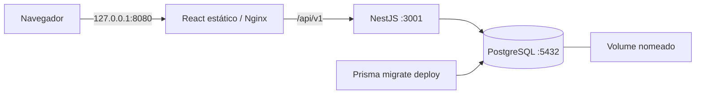

# Containers portáveis

Configuração de containers para [PedroLLou/tcc20261](https://github.com/PedroLLou/tcc20261).

As imagens usam Containerfiles padrão e Compose. Podman é o runtime local; Docker também pode executar a mesma configuração. Não há dependência de provedor de nuvem, diretórios do host, socket do runtime dentro dos containers ou arquitetura de CPU fixada. As imagens são Linux; máquinas Windows/macOS precisam de um runtime com VM Linux. ARM64 e builds com emulação ainda precisam de teste.

## Serviços e eficiência



| Imagem | Construção e execução |
| --- | --- |
| Frontend | Node 24 compila React; a imagem final contém Nginx sem root e `build/`, sem Node, npm ou dependências do frontend |
| API | Node 24 em Debian slim, dependências de produção e cliente Prisma gerado; executa `node dist/src/main.js` sem compilador ou CLI Prisma |
| Migração | Node 24, CLI Prisma e dependências de produção; aplica somente as migrações existentes e encerra |
| Banco | `docker.io/library/postgres:17-alpine`, dados em `/var/lib/postgresql/data`; o projeto não requer extensões externas |

Instalações usam `npm ci` e os lockfiles existentes. Os estágios de dependências permitem reutilizar o cache ao alterar os fontes. Builds e dependências locais ficam fora dos contextos. O runtime da API remove dependências de desenvolvimento e opcionais, incluindo o CLI Prisma que `@prisma/client` referencia como peer opcional. O build verifica a ausência de Prisma CLI/TypeScript e o carregamento de Prisma Client, bcrypt e dotenv. O CLI Prisma passou para `devDependencies`; `dotenv`, importado pelo projeto, agora é dependência direta.

O frontend usa `/api/v1` no navegador. A autenticação reutiliza o cliente HTTP de `api.ts` e rotas `/auth/*`, corrigindo o prefixo duplicado `/api/v1/api/v1` na configuração relativa ou de API externa. Nginx resolve `api` pelo DNS de `/etc/resolv.conf` da rede do runtime, sem endereço de DNS específico do Docker, e atualiza a resolução se a API for recriada. A configuração gerada e os arquivos temporários ficam em `/tmp`, permitindo filesystem somente leitura. O frontend comprime respostas, armazena assets com hash em cache e não publica sourcemaps. HTML não recebe cache longo; um asset ausente retorna 404; outros caminhos recebem o fallback da SPA.

As bases possuem registro e versão explícitos. Os argumentos `NODE_IMAGE` e `WEB_IMAGE` permitem espelhos ou digests. Tags podem receber atualizações de segurança e não garantem bytes idênticos: registrar os digests depois do primeiro build validado. Tamanho, RAM, latência e comparação entre arquiteturas ainda não foram medidos. Debian slim mantém compatibilidade com Prisma/OpenSSL e bcrypt; uma troca para Alpine exige testar as bibliotecas nativas antes de comparar o ganho.

## Preparação com Podman 5.8.2

A partir da pasta que contém os dois repositórios:

```sh
cd tcc20261
podman -v
podman info
podman compose --help
podman compose version
```

`podman -v` confirma a versão. `podman info` confirma acesso ao runtime. `podman compose` é um wrapper que delega a `podman-compose` ou `docker-compose`; ele não inclui um provedor. `--help` e `version` conferem o provedor realmente instalado. A sintaxe do wrapper e os comandos de build foram consultados na [documentação do Podman 5.8.2](https://docs.podman.io/en/v5.8.2/markdown/podman-compose.1.html).

Se aparecer `looking up compose provider failed`, o provedor não foi encontrado. Em Arch Linux, instalar o pacote oficial no terminal normal:

```sh
sudo pacman -S podman-compose
export PODMAN_COMPOSE_PROVIDER=/usr/bin/podman-compose
podman compose version
```

O [pacote do Arch](https://archlinux.org/packages/extra/any/podman-compose/) inclui as dependências Python. Esse preparo é do host; não altera imagens, Compose ou dependências da aplicação. Outros sistemas devem seguir os [métodos oficiais de instalação](https://github.com/containers/podman-compose#installation). O provedor Python executa Podman diretamente, sem exigir um serviço Docker.

Se houver mais de um provedor, selecionar explicitamente o desejado:

```sh
export PODMAN_COMPOSE_PROVIDER=podman-compose
podman compose --help
```

O provedor precisa implementar `service_healthy` e `service_completed_successfully` do padrão Compose. Não substituir essas condições por atrasos fixos: a API faz consultas e cria o administrador ao inicializar, portanto precisa encontrar o schema já migrado.

Limite observado por inspeção do [código de `podman-compose` 1.6.0](https://github.com/containers/podman-compose/blob/v1.6.0/podman_compose.py): `service_completed_successfully` aguarda a parada da migração sem conferir o código de saída impresso por `podman wait`. A condição declarada sozinha não comprova sucesso nesse provedor. Antes de usar os dados ou declarar a implantação validada, conferir o resultado da migração e executar o verificador completo, que também exige sucesso de `prisma migrate status`. Esse comportamento em caso de falha da migração ainda precisa de teste.

Para o helper de configuração e os testes, usar Node 24 ou superior. Para a verificação completa, usar também Bash e curl. A execução das imagens não exige Node ou npm no host.

## Configuração e inicialização

```sh
node scripts/create-container-env.mjs
podman compose config >/dev/null
podman compose build
podman compose up -d
podman compose ps
```

> **`.env` gerado antes de 12/10/2026:** o container de migração passou a exigir `DIRECT_URL` (conexão do dono do banco, usada pelo Prisma Migrate). No banco local do Compose, acrescente ao `.env` a linha `DIRECT_URL=` com o mesmo valor da `DATABASE_URL`. Ver [`docs/banco-de-dados.md`](banco-de-dados.md).

O helper cria `.env` com permissão `0600`, três segredos aleatórios independentes e URL de banco consistente. Ele recusa sobrescrever um arquivo existente. `.env.example` documenta as variáveis sem incluir senhas funcionais. Compose recusa segredos vazios. Inspecionar as credenciais localmente para fazer login; não publicar o arquivo nem a saída completa de `compose config`, que contém os segredos interpolados.

Abrir `http://127.0.0.1:8080`. O administrador sintético inicial usa `DEFAULT_ADMIN_RH_EMAIL` e `DEFAULT_ADMIN_RH_PASSWORD` de `.env`. O projeto cria esse administrador apenas se ainda não houver um usuário `ADMIN_RH`; mudar a senha no arquivo após o primeiro início não redefine a senha armazenada.

Para outra porta, alterar `WEB_PORT` em `.env`. A API e o banco ficam na rede interna. O arquivo básico publica apenas o frontend em loopback. Hospedagem remota deve definir publicação, domínio, HTTPS, gestão de segredos e backup conforme o ambiente escolhido.

A ordem é banco saudável, migração concluída, API saudável, frontend. A verificação da API consulta a rota existente `GET /api/v1/auth/teams`, que acessa o banco. O histórico ativo tem dez migrações em `backend/prisma/migrations/`; não se usa `db push` nem o schema histórico do repositório `TCC`.

Para construir diretamente com Podman, sem Compose:

```sh
podman build --target runtime -f backend/Containerfile -t localhost/tcc20261-api:local backend
podman build --target migration -f backend/Containerfile -t localhost/tcc20261-migrate:local backend
podman build -f frontend/Containerfile -t localhost/tcc20261-frontend:local frontend
```

Esses comandos só constroem as imagens. Rede, volume, variáveis, execução da migração e inicialização ainda precisam ser coordenados pelo ambiente de execução. Em Docker, os mesmos Containerfiles podem ser construídos com `docker build`.

## Parada, atualização e dados

```sh
podman compose logs --tail=80
podman compose down
podman compose build
podman compose up -d
```

`down` remove containers e rede, preservando `postgres_data`. Ao subir novamente, a migração é repetida de forma idempotente e a API usa o volume preservado. Usar o mesmo nome de projeto e arquivo `.env` para reencontrar o volume. Trocar `POSTGRES_PASSWORD` em `.env` não altera a senha de um banco já inicializado.

Somente para apagar deliberadamente os dados desse projeto:

```sh
podman compose down --volumes
```

## Validação reproduzível

A partir da pasta pai dos repositórios:

```sh
bash tcc20261/scripts/verify-containers.sh
```

Ou executar o mesmo teste com Docker:

```sh
CONTAINER_ENGINE=docker bash tcc20261/scripts/verify-containers.sh
```

O script usa um nome de projeto exclusivo, credenciais temporárias e a porta 18080. `TEST_WEB_PORT=18081` permite mudar a porta. Ele:

1. Confere runtime e provedor Compose e executa os testes do gerador de `.env`.
2. Constrói estágios de teste, executa a regressão das URLs com as dependências travadas, os testes atuais de backend/frontend e constrói as imagens finais.
3. Inicia os serviços, aguarda HTTP e consulta `prisma migrate status`.
4. Confere HTML React, JavaScript, fallback SPA, resposta 404 para asset ausente e chamadas pelo proxy.
5. Testa login, rejeição de credenciais inválidas e permissões; cria equipe, líder e membro sintéticos.
6. Cria rascunho de feedback, envia para validação e aprova como RH.
7. Recria os containers mantendo o volume e confere equipe, usuários e feedback.
8. Remove os containers, rede, volume e arquivos temporários exclusivos desse teste, inclusive em caso de falha. As imagens e o cache de build permanecem reutilizáveis.

O teste HTTP exerce a API através do frontend, mas não clica na interface. Um teste de navegador completo e validação de desempenho continuam separados.

## Validação local

Em 04/10/2026, `podman compose up -d --build` concluiu os builds de frontend, API e migração. PostgreSQL, API e frontend ficaram saudáveis; a migração encerrou com código zero e sem migrações pendentes.

As consultas HTTP confirmaram `200` no frontend, `ok` em `/healthz` e resposta da API em `/api/v1/auth/teams` pelo proxy. A aplicação está disponível em `http://127.0.0.1:8080`.

O script `scripts/verify-containers.sh` permite repetir os testes de aplicação e verificar login, autorização, fluxo de feedback e persistência em um projeto isolado.

## Referências consultadas

- [Podman 5.8.2: construção e contexto](https://docs.podman.io/en/v5.8.2/markdown/podman-build.1.html)
- [Podman 5.8.2: provedor Compose](https://docs.podman.io/en/v5.8.2/markdown/podman-compose.1.html)
- [Compose: ordem e condições de prontidão](https://docs.docker.com/compose/how-tos/startup-order/)
- [Nginx sem root](https://github.com/nginx/docker-nginx-unprivileged)
- [Nginx: resolução pelo DNS local](https://github.com/nginx/docker-nginx-unprivileged/blob/main/entrypoint/15-local-resolvers.envsh)
- [Imagem PostgreSQL: variáveis e volume](https://hub.docker.com/_/postgres)
