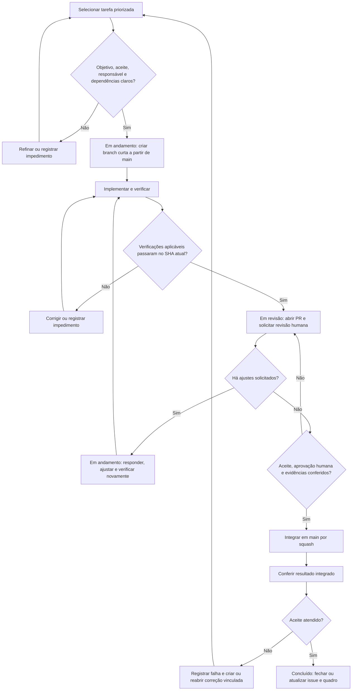

# Workflow de desenvolvimento

> Atualização de 17/10/2026 para discussão no PR #100. O uso atual do Hermes está descrito na seção 4. As regras de organização, revisão e merge abaixo continuam como proposta para a equipe; este documento não configura proteções ou checks obrigatórios no GitHub.

Usamos o **GitHub Flow** como base: cada alteração fica em uma branch curta e entra na `main` por um Pull Request (PR). A issue descreve a tarefa, e o quadro mostra em que etapa ela está.

## Fluxo da tarefa

Há uma versão resumida em [PNG](diagrams/workflow-tcc2.png) e [SVG](diagrams/workflow-tcc2.svg), com [arquivo editável no draw.io](diagrams/workflow-tcc2.drawio). O Mermaid acima detalha as decisões e os retornos. O tratamento de falhas e impedimentos está explicado nas seções seguintes.

## 1. Escolher e preparar a tarefa

Antes de começar outra tarefa, veja se há algum PR que você pode ajudar a revisar.

Escolha uma issue priorizada e combine o responsável, o objetivo, os critérios de aceite e as dependências. Se faltar informação ou houver um bloqueio, registre isso na issue e combine o próximo passo. Um ajuste pequeno pode ficar só no PR, com o motivo explicado.

| Estado | Quando usar |
|---|---|
| Pendente | A tarefa está cadastrada, mas o trabalho ainda não começou. |
| Em andamento | Alguém está trabalhando nela ou fazendo ajustes pedidos na revisão. |
| Em revisão | O PR está pronto para outra pessoa revisar. |
| Concluído | O resultado integrado foi conferido e atende ao combinado. |

Vincule issue e PR. Se os dois tiverem cartões no quadro, mantenha os estados coerentes com o trabalho real, para a mesma tarefa não aparecer simultaneamente como pendente e em revisão. O comentário do Hermes não muda o cartão automaticamente.

## 2. Desenvolver e verificar

Preserve suas mudanças locais antes de atualizar a main. Crie uma branch curta a partir da versão atualizada.

Use `tipo/N-descricao-curta` quando houver issue, como `docs/96-workflow-tcc2`, ou `tipo/descricao-curta` quando não houver. Faça commits pequenos no formato `tipo(escopo): descrição`, em português, minúsculas e sem ponto final. Exemplo: `docs(gcs): atualiza workflow`. Tipos usuais: `feat`, `fix`, `docs`, `test`, `refactor`, `chore` e `ci`.

Antes de pedir revisão:

- confira o próprio diff;
- execute testes, build e outras verificações pertinentes à mudança;
- registre comandos ou passos, resultados, limitações e o commit verificado;
- confira os checks do commit atual. O SHA é o identificador desse commit.

Explique quais comportamentos os testes cobrem. Conforme a mudança, podem ser necessários testes unitários, de integração ou cenários funcionais. Em correções de defeito, indique o teste de regressão ou justifique por que ele ainda não existe. Verificações manuais devem ser identificadas como manuais. Para documentação, confira conteúdo, links e diagramas.

**O conjunto mínimo de testes e cenários funcionais ainda precisa ser fechado com os responsáveis e a equipe.** Esta proposta não determina que apenas testes unitários bastam nem exige integração ou teste de tela em todo PR.

Um teste que passou antes dos últimos ajustes não confirma a versão atual. Se um check falhar, investigue e registre a causa, o link da execução, o impacto e o encaminhamento. Uma falha anterior à mudança continua sendo uma pendência; seu registro não transforma o check em aprovado nem autoriza ignorar falhas automaticamente.

## 3. Abrir o PR e pedir revisão

Abra o PR para main, preencha o template e peça revisão de outro integrante. Use Draft enquanto o trabalho estiver incompleto. Relacione a tarefa com `Refs #N`. A proposta é fechar a issue depois de conferir o resultado na main; use `Closes #N` somente se o merge concluir toda a tarefa e o grupo tiver combinado o fechamento automático.

Ao pedir revisão, mova a tarefa para **Em revisão**. O revisor confere:

- atendimento ao requisito e aos critérios de aceite;
- comportamento, riscos e suficiência das verificações apresentadas;
- aderência à arquitetura, citando a seção, diagrama ou contrato pertinente e justificando eventuais desvios;
- respostas aos apontamentos e correspondência entre aprovação e commit atual.

Se forem solicitados ajustes, o autor responde, volta a tarefa para **Em andamento**, corrige e repete as verificações. Depois, pede nova revisão. Um comentário fora do escopo pode virar uma tarefa vinculada, com responsável e motivo, sem exigir uma issue para cada observação.

Novos commits precisam ser conferidos mesmo que já exista uma aprovação anterior. Evite reescrever o histórico depois que a revisão começar. Se precisar fazer isso ou resolver um conflito que mude o diff, avise o revisor.

## 4. Usar o Hermes como apoio à revisão

O Hermes já publica comentários automáticos de apoio em PRs do projeto. A rotina usa webhook como entrada principal e começa a análise somente depois de os testes passarem na versão atual de um PR aberto, não Draft e destinado à main. Mudanças exclusivamente documentais ficam fora do escopo definido para a IA. A verificação desse filtro e outras melhorias técnicas são acompanhadas separadamente.

O comentário identifica o commit e pode apontar problemas, informar ausência de achados ou declarar análise parcial. **Teste aprovado, ausência de achados e aprovação humana são evidências diferentes.** A IA não aprova, reprova formalmente ou faz merge do PR e não altera o código.

Quem trata cada apontamento é o **autor do PR**:

1. Confere se o cenário existe e se o problema se aplica à alteração.
2. Se procede, corrige na mesma branch e informa o commit e a verificação realizada.
3. Se não procede ou depende de uma condição não confirmada, explica o motivo e apresenta a evidência disponível.
4. Se depende de outra pessoa ou sai do escopo, registra o encaminhamento e a pendência.

O **revisor humano** confere a resposta e o código final e decide sobre aprovação. Quem faz o merge verifica se essa aprovação corresponde à versão atual. A presença de um comentário do Hermes não transfere as correções para quem vai integrar o PR.

Há um comentário automático próprio por PR, atualizado a cada análise. Enquanto a preservação do histórico dos achados é aprimorada, identifique na resposta o problema e o commit analisado; uma atualização do comentário pode trazer um problema diferente. Não apague a distinção entre um achado corrigido e um novo apontamento.

Para avaliar a utilidade da assistência, registre por achado a versão, a decisão humana, a justificativa, a correção e o teste quando houver. Diferencie sugestão útil, incorreta e inconclusiva. Um resultado sem achados não comprova ausência de defeitos nem mede a qualidade geral da IA.

## 5. Fazer o merge e concluir

Antes do merge, confira o aceite, a aprovação de outro integrante sobre o commit atual, o tratamento dos comentários e as verificações aplicáveis. Falhas e exceções precisam de encaminhamento explícito; não são dispensadas pelo Hermes. O método proposto é **squash and merge**, que reúne os commits do PR em um commit na main.

Depois do merge, confira o resultado integrado. Só então feche ou atualize a issue e mova o cartão para **Concluído**, com os links do PR e das verificações. Se algo não funcionar, registre o problema e reabra a tarefa ou crie uma correção relacionada.

A branch pode ser removida depois da integração, desde que não tenha trabalho pendente. Em tarefas de configuração sem PR, registre a mudança, confira o resultado e peça revisão de outro integrante.

## Configurações que ainda precisam ser combinadas

Esta documentação não ativa bloqueios. Na conferência de 17/10/2026, a main não tinha proteção efetiva. O grupo precisa definir e conferir aprovação por outro integrante, tratamento de novos commits, resolução de comentários, permissões de exceção e checks obrigatórios.

Os checks com falhas existentes precisam de tratamento pelos responsáveis antes de se escolher o bloqueio definitivo. Confirme os nomes nas execuções reais e valide a configuração em PR. A aprovação desta proposta, o padrão mínimo de testes e a configuração técnica da proteção são etapas distintas.
